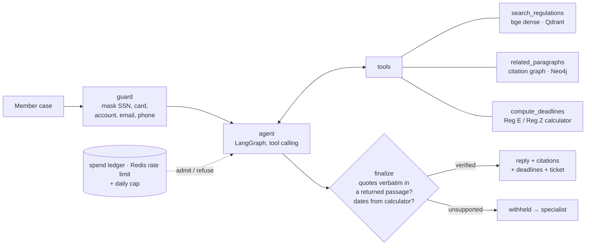

# RegLens

A member-service copilot for credit-union staff, grounded in federal consumer-banking regulations.

**Live demo: https://reglens-blush.vercel.app**. The Copilot tab replays real recorded runs (Claude Haiku 5.5), including one where the verifier withholds a reply. The deadline calculator, the "try to fool the checker" panel, semantic search and the citation-graph explorer run live with no key. Live answering turns on only with a model key and the Redis rate limiter.

A representative pastes what a member said: "my debit card was stolen Tuesday, I called the next morning, there's a $400 charge I didn't make". The copilot:
- classifies the case
- searches the regulations, then follows the citation graph to the Official Interpretations
- computes the member's actual deadlines and liability cap
- drafts a reply and opens a handoff ticket

**The model proposes; deterministic code decides what reaches the member:**
- **Claims:** every claim must be a verbatim quote from a passage a tool returned in this session.
- **Dates:** every date must come from the calculator.
- **Disputes:** these always create a ticket.
- **Anything unsupported** is withheld and routed to a person.

**Corpus.** Pinned eCFR text as of 2026-10-02, with a SHA-256 for every source file:
- Regulation E (12 CFR 1005)
- NCUA Part 707, Truth in Savings
- Regulation CC (12 CFR 229)
- Regulation Z §§1026.12–1026.13

That's 2,371 paragraphs, including Official Interpretations, in 2,495 citation-addressed chunks. They are linked by a citation graph of 2,276 edges.



A second, fixed pipeline (guard → retrieve → generate → verify → one retry → finalize) answers single questions. It is the system under test in the hallucination evaluation.

## What is measured

Every report under [evals/reports/](evals/reports/) records:
- the corpus manifest hash
- the golden-set hash
- the prompt version
- the git commit

### Retrieval

Measured on 33 answerable golden questions at k=8, with 95% bootstrap CIs over questions.

| Retriever | Recall@1 | Recall@5 | Recall@8 | MRR |
|---|---|---|---|---|
| BM25 (from scratch) | 0.18 | 0.24 (0.09–0.39) | 0.24 | 0.20 |
| **Dense, bge-small-en-v1.5** | **0.48** | **0.76 (0.61–0.88)** | **0.85** | **0.60** |
| Hybrid BM25 + dense, RRF c=60 | 0.27 | 0.46 (0.27–0.64) | 0.61 | 0.36 |
| Dense + MS-MARCO cross-encoder rerank | 0.39 | 0.67 (0.52–0.82) | 0.82 | 0.52 |
| Dense + citation-graph expansion (1 seed) | 0.48 | 0.70 (0.55–0.85) | 0.82 | 0.58 |

The obvious defaults would have been wrong:
- **Hybrid underperforms dense alone.** Paired recall@5 is −0.30, 95% CI [−0.45, −0.15]. Members write "credit union" and "debit card"; the regulation says "financial institution" and "access device". BM25 therefore ranks Regulation Z credit-card commentary first, and RRF gives that noise equal weight.
- **Neither a general-domain reranker nor graph expansion improves first-stage recall** (−0.09 and −0.06; both CIs include 0). Dense search usually finds the gold paragraph already, and expansion pushes direct hits out of the top k. The graph is therefore an *agent tool*: open a rule's Official Interpretation, follow a cross-reference. It is not a ranking signal.
- **These conclusions come from a small, author-written set** (see Limitations).

### Stores

`reglens eval stores` checks each backend against the in-memory reference implementation, using the live servers.

| Backend | Check | Result |
|---|---|---|
| Qdrant 1.20 (2,495 × 384, HNSW m=16) | exact search top-8 identical to numpy | 43/43 golden queries |
| | HNSW recall@8 vs exact | 1.00 |
| Neo4j 5.26 (2,371 nodes, 2,276 relationships) | neighbors identical to in-memory graph | 2,371/2,371 nodes |

### Answers (Claude Haiku 5.5, 43 questions)

`reglens eval answers` scores four configurations with one function:
- **A**, closed book
- **B**, RAG without the verifier
- **C**, RAG with the verifier
- **D**, the copilot agent

The 43 questions split into 33 answerable, 4 out of corpus and 6 that should be refused. Five are adversarial: prompt injection, PII-laden, system-prompt extraction, role-played legal advice and a false premise.

"Answer accuracy" is stricter for retrieval configurations, since it also requires a verified quote from a gold paragraph. So the like-for-like columns below use one definition for every configuration:

| Configuration | Right fact | Answer backed by a verified quote from the gold paragraph | Declined when it should | Unsupported claims shown | Cost / question |
|---|---|---|---|---|---|
| A, closed book | 0.82 (0.67–0.94) | n/a (no sources) | 1.00 | 0.9% fabricated citations | $0.0006 |
| B, RAG, no verifier (k=8) | 0.82 (0.70–0.94) | 0.79 (0.64–0.91) | 1.00 | 0% | $0.0009 |
| C, RAG + verifier (k=12) | 0.88 (0.76–0.97) | 0.88 (0.76–0.97) | 1.00 | 0% | $0.0010 |
| **D, copilot** | **0.94 (0.85–1.00)** | **0.97 (0.91–1.00)** | **1.00** | **0%** | **$0.0013** |

Run 1 is [20261025-155616](evals/reports/20261025-155616-answers/REPORT.md) and run 2 is [20261025-161115](evals/reports/20261025-161115-answers/REPORT.md), with 95% bootstrap CIs over questions.

**What this shows:**
- **A small modern model already knows these well-known rules.** Closed book is right 82% of the time, so the system's value isn't raw accuracy.
- **Its value is verifiability.** The copilot backs 97% of answered questions with a checked quote from the exact paragraph, against none closed book, and every unsupported claim a model drafted was removed before display.
- **The copilot's gain over closed book is not significant.** On right fact it is +0.12, 95% CI [0.00, +0.27], so on 33 questions it is not claimed.

**Two changes were measured between runs:**
- **k 8 → 12:** chosen from the retrieval curve alone, recall@8 0.85 to recall@12 0.91, flat after.
- **A `not_covered` case type:** the copilot had scored 0.00 on out-of-corpus questions because benign "not covered" questions and refusals shared one label. It now scores 1.00.

### Copilot scenarios (10 member cases × 3 repeats)

`reglens eval copilot` runs 10 realistic cases ([evals/copilot_cases.jsonl](evals/copilot_cases.jsonl)): relative dates ("yesterday"), a missed 60-day statement window, a new-account extension, a legal-advice request and a prompt injection inside a real case. Expected liabilities and deadlines come from running the calculator on reference arguments, which `tests/test_copilot_cases.py` keeps in sync with the code.

| Metric | 30 case runs |
|---|---|
| Case type correct | 0.97 (0.90–1.00) |
| Calculator called when dates were given | 1.00 |
| Liability and deadlines exactly right (the agent read the dates correctly) | **1.00** |
| Handoff correct | 0.93 (0.83–1.00) |
| Reply released | 0.93 (0.81–1.00) |
| Claims drafted that failed verification (removed) | 3.7% |
| Unsupported claims shown | **0** |
| Cost per case | $0.0033 |

The misses are informative:
- **Over-escalation:** a general check-hold question got a ticket it didn't need.
- **Correctly withheld replies:** two drafts stated the general $50 and $500 tiers without a verified quote or calculator output behind them.

The first copilot run also surfaced two verifier false positives, both fixed and tested:
- a total of member-given amounts
- a member's date written without a year

Model runs refuse to start without a USD cap, and `--dry-run` prints the worst-case cost first. The whole evaluation programme so far, including retries and recorded runs, cost **$0.47**.

### Prompt caching

The copilot requests one cache breakpoint per turn on the Anthropic API. On real runs **64–74% of input tokens were read from cache**, which cut per-case cost by about 31% at Haiku's cache-read rate. Spend accounting bills cache writes at 1.25× and reads at the configured cache price. When no cache price is set, reads are billed at the full input price, so caching can never make the cap under-count.

## Deterministic components

**Deadline calculator** (`timeline.py`) covers:
- Reg E unauthorized-transfer liability: $50 within two business days, up to $500 after that, and the 60-day statement rule
- Reg E error-resolution deadlines: 10/20 business days, 45/90 days, provisional credit
- Reg Z billing-error windows and the $50 card-liability cap

It runs on a Federal Reserve business-day calendar. Every rule carries a verbatim quote, and a test checks each quote against the pinned regulation. Results that depend on facts the institution must establish are reported as maximums, never as decisions.

**Citation graph** (`kg/`) has two edge types, both parsed from the text and citation scheme, never by a model:
- **INTERPRETS:** comment → rule
- **CITES:** "§ 1005.11(c)(2)", "paragraph (b)(1) of this section", "comment 18(b)(2)-2"

A heading-only paragraph resolves to its first child. 87 references point outside the corpus; they are counted, not guessed.

**Verifier** (`verify.py`) accepts a claim only if:
- its chunk was returned for this question
- its quote is a verbatim substring of that passage after whitespace and quote-mark normalization
- the quote is at least 25 characters

## Controls

| Risk | Control | Where |
|---|---|---|
| Invented rule, deadline or amount | Verbatim-quote check against passages a tool returned; one retry with feedback; unverified claims dropped | `verify.py`, `graph.py`, `copilot.py` |
| Model date or money arithmetic | Dates and dollar amounts in a reply must come from the calculator, a verified quote or the member's own message, otherwise the reply is withheld | `timeline.py`, `copilot.py` |
| Live member problem | Disputes and unauthorized use always produce a handoff ticket; unsupported replies withheld for a person | `copilot.py` |
| PII in member text | SSN, card, account, email, phone masked before retrieval, model and traces | `guard.py` |
| Cost | Every call admitted against its worst case before it is sent; hard USD cap across runs; public reservations settle to measured spend, even when a run fails | `guard.py`, `generator.py`, `server/` |
| Abuse on a public URL | Per-IP hourly limit and global daily USD cap in Redis; fails closed without a durable store | `server/limits.py` |
| Prompt injection | Member text and tool output treated as data; verifier checks text, not intent; adversarial golden items | `prompts.py`, `copilot.py` |
| The law changes | Weekly job compares eCFR amendment history with the pinned snapshot and fails on any in-scope amendment | `corpus/freshness.py`, `law-watch.yml` |
| Web surface | Strict CSP (no inline script), no framing, request ids, JSON errors without tracebacks, access logs with paths only (never member text), retriever allowlist | `server/app.py` |
| Regression | Hashes and commit in every report; CI runs lint and format checks, tests against real Qdrant and Neo4j, the offline eval, and a Kubernetes deploy with a smoke test | `eval/`, `.github/workflows/ci.yml` |
| Observability | OpenTelemetry spans per step with `gen_ai.*` token attributes; JSONL locally, OTLP to any backend | `telemetry.py` |

## Run it

```bash
python -m venv .venv && . .venv/bin/activate
pip install -e ".[dev,serve]"
pytest -q                     # unit, golden, calculator, copilot, server; store tests need QDRANT_URL / NEO4J_URI
reglens eval retrieval        # downloads bge-small on first run
reglens-serve                 # http://127.0.0.1:8000  (API reference at /api/docs)
reglens check-law             # has any in-scope regulation been amended since the snapshot?
cd e2e && npm ci && npx playwright install chromium && npx playwright test   # browser flows + axe WCAG 2 AA, both themes
```

**Full stack (app + Qdrant + Neo4j + loader):** `docker compose up --build`

**Kubernetes:** see [deploy/k8s/](deploy/k8s/). It includes:
- Qdrant and Neo4j StatefulSets with persistent volumes
- an idempotent loader Job
- the app Deployment: non-root, read-only root filesystem, startup/readiness/liveness probes, HPA, PDB
- a NetworkPolicy so only RegLens pods reach the stores

```bash
kind create cluster --name reglens
docker build -t reglens:local . && kind load docker-image reglens:local --name reglens
kubectl apply -k deploy/k8s && deploy/k8s/smoke.sh
```

**Model access.** Copy `.env.example` to `.env` and choose a provider:
- `LLM_PROVIDER=anthropic` (Claude)
- `azure` (Azure OpenAI)
- `openai` (OpenAI or any compatible gateway)

Model runs refuse to start without `REGLENS_USD_CAP` and `PRICE_*`. `reglens eval answers --dry-run` prints the upper-bound cost without calling a model.

```bash
reglens ask "My debit card was stolen and I called this morning. What is the most I could lose?"
reglens eval copilot --dry-run && reglens eval copilot
reglens eval answers --dry-run --repeats 3 && reglens eval answers --repeats 3
```

The copilot is also served as server-sent events (`POST /api/copilot/stream`): one event per agent turn and tool call, then the verified result. The demo's pipeline view lights up from these events.

## Layout

```
src/reglens/corpus/      eCFR fetch (hashed), paragraph parser (6-level CFR labels, interpretations), chunker,
                         law-change monitor
src/reglens/retrieval/   BM25, dense, RRF hybrid, bge + cross-encoder, graph expansion, Qdrant, Azure AI Search
src/reglens/kg/          citation graph; Neo4j store and GraphService
src/reglens/timeline.py  Reg E / Reg Z deadline and liability calculator
src/reglens/copilot.py   LangGraph tool-calling agent with deterministic finalize
src/reglens/graph.py     LangGraph Q&A pipeline: guard → retrieve → generate → verify → finalize
src/reglens/verify.py    verbatim quote verifier
src/reglens/guard.py     PII masking, spend ledger
src/reglens/eval/        golden-set runner, bootstrap CIs, paired deltas, store parity, reports
src/reglens/server/      FastAPI service (SSE copilot stream, security headers, limits), demo UI (static/)
deploy/k8s/              kustomize manifests + smoke test
evals/golden.jsonl       43 labelled questions;  evals/copilot_cases.jsonl  10 member cases
evals/reports/           every run, with provenance
docs/MODEL_CARD.md       intended use, limits, evaluation, governance hooks
```

## Limitations

- **The golden set is small and author-written.** 43 questions shows large effects with CIs, not small ones, and nothing has been labelled by members or compliance staff. Choosing a retriever on the same set it is reported on is optimistic.
- **Exact-substring verification proves a quote exists, not that the claim interprets it correctly.** Human review remains the control for interpretation.
- **The business-day calendar is an assumption.** It uses Federal Reserve holidays; Reg E defines business days by when the institution is open.
- **The corpus is a point-in-time snapshot.** Two parser repairs are logged in `data/processed/corpus_stats.json`.
- **This explains regulations; it does not decide a member's case.** Institution policies, rates and account data are out of scope by design.

## Author

**Sai Akhilesh Vangala** ([@Akhilesh-Vangala](https://github.com/Akhilesh-Vangala)), New York University. Design,
implementation and evaluation. Released under the [MIT License](LICENSE); see [CITATION.cff](CITATION.cff) to cite.
