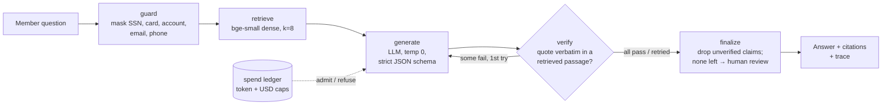

# RegLens

Governed retrieval-augmented answers about consumer-banking regulations, for member-service staff.

A member asks "my debit card was stolen and I called this morning, what's the most I could lose?". RegLens answers only from the regulation text: every sentence carries a citation and a verbatim quote, and deterministic code checks both before anything is shown. A claim that can't be verified is removed. An answer left with nothing verified goes to a person, not to the member.

**Corpus.** Pinned eCFR text as of 2026-10-02, with a SHA-256 for every source file:
- Regulation E (12 CFR 1005)
- NCUA Part 707, Truth in Savings
- Regulation CC (12 CFR 229)
- Regulation Z §§1026.12–1026.13

That's 2,371 paragraphs, including Official Interpretations, in 2,495 citation-addressed chunks.



## What is measured

### Retrieval

Measured on 33 answerable golden questions at k=8, with 95% bootstrap CIs over questions. Source report: [evals/reports/](evals/reports/).

| Retriever | Recall@1 | Recall@5 | Recall@8 | MRR |
|---|---|---|---|---|
| BM25 (from scratch) | 0.18 | 0.24 (0.09–0.39) | 0.24 | 0.20 |
| **Dense, bge-small-en-v1.5** | **0.48** | **0.76 (0.61–0.88)** | **0.85** | **0.60** |
| Hybrid BM25 + dense, RRF c=60 | 0.27 | 0.46 (0.27–0.64) | 0.61 | 0.36 |
| Dense + MS-MARCO cross-encoder rerank | 0.39 | 0.67 (0.52–0.82) | 0.82 | 0.52 |

The obvious default would have been wrong:
- **Hybrid underperforms dense alone.** Paired recall@5 is −0.30, with a 95% CI of [−0.45, −0.15]. Members write "credit union" and "debit card"; the regulation says "financial institution" and "access device". BM25 therefore ranks Regulation Z credit-card commentary first, and RRF gives that noise equal weight.
- **The general-domain reranker doesn't help either** (−0.09, CI includes 0). The service therefore defaults to dense retrieval.
- **These conclusions are drawn on a small, author-written set** (see Limitations). Azure AI Search hybrid (`azure_hybrid`) is implemented for the production path, but it hasn't been measured yet.

### Answers

`reglens eval answers` compares three configurations on 43 questions:
- **A**, closed book
- **B**, RAG without the verifier
- **C**, RAG with the verifier

The 43 questions split into 33 answerable, 4 out of corpus and 6 that should be refused, including prompt-injection, PII-laden, system-prompt-extraction and false-premise items.

Metrics:
- answer accuracy: correct status, plus the required fact, plus a verified claim citing a gold paragraph
- unsupported-claim rate before and after the verifier
- fabricated-citation rate for the closed-book configuration
- refusal, out-of-corpus and escalation accuracy
- tokens, latency and cost per question
- paired deltas between configurations

*This run needs model credentials and has not been run yet; no answer-quality numbers are claimed until it has.*

Every gold fact is checked against the regulation text in CI (`tests/test_golden.py`). If the law changes, the labels fail before any model call does.

## Controls

| Risk | Control | Where |
|---|---|---|
| Hallucinated rule, deadline or dollar amount | Claim kept only if its quote is a verbatim substring of a passage retrieved for this question; one retry with verifier feedback | `verify.py`, `graph.py` |
| Citing a passage the model never saw | `not_retrieved` rejection even if the passage exists in the corpus | `verify.py` |
| Live member problem (fraud, lost card, dispute) | `needs_human_review` flag; unverifiable answers are downgraded and routed to staff | `prompts.py`, `graph.py` |
| PII in questions | Masked before retrieval, the model and traces; only counts are logged | `guard.py` |
| Runaway cost | Per-request token cap and cumulative USD cap, checked *before* each call | `guard.py` |
| Prompt injection via question or passage | Passages marked untrusted; verifier ignores model intent and checks text | `prompts.py`, golden A01–A05 |
| Silent regression | Versioned prompt, corpus hash, golden hash and git commit in every report; CI runs tests and the offline retrieval eval | `eval/run.py`, `.github/workflows/ci.yml` |
| Observability | OpenTelemetry spans per step with `gen_ai.*` token attributes; JSONL locally, OTLP to any backend | `telemetry.py` |

## Run it

```bash
python -m venv .venv && . .venv/bin/activate
pip install -e ".[dev,serve]"
pytest -q                                   # 67 tests, offline
reglens eval retrieval                      # downloads bge-small (~130 MB) on first run
reglens-serve                               # http://127.0.0.1:8000
```

**Without credentials**, the demo still runs retrieval over all retrievers, shows the pinned-corpus provenance and the measured results. `/api/ask` returns 503 with the missing setting.

**To enable answers**, copy `.env.example` to `.env` and pick a provider:
- `LLM_PROVIDER=azure`: Azure OpenAI deployments, plus optional Azure AI Search for `reglens index`.
- `LLM_PROVIDER=openai`: the OpenAI API or any OpenAI-compatible gateway.

Optionally set `PRICE_*` per 1M tokens to get cost reporting and enforce `REGLENS_USD_CAP`. Then:

```bash
reglens ask "My debit card was stolen and I called this morning. What is the most I could lose?"
reglens eval answers --repeats 3
```

Docker:

```bash
docker build -t reglens . && docker run -p 8000:8000 --env-file .env reglens
```

## Layout

```
src/reglens/corpus/      eCFR fetch (hashed), paragraph parser (6-level CFR labels, interpretations), chunker
src/reglens/retrieval/   BM25, dense, RRF hybrid, local bge + cross-encoder, Azure AI Search hybrid
src/reglens/generation/  versioned prompts, Pydantic answer schema, LangChain structured-output client
src/reglens/graph.py     LangGraph state machine: guard → retrieve → generate → verify → finalize
src/reglens/verify.py    deterministic quote verifier
src/reglens/guard.py     PII masking, spend ledger
src/reglens/eval/        golden-set runner, bootstrap CIs, paired deltas, reports
src/reglens/server/      FastAPI service + single-page demo
evals/golden.jsonl       43 labelled questions;  evals/reports/  every run, with provenance
docs/MODEL_CARD.md       intended use, limits, evaluation, governance hooks
```

## Limitations

- **The golden set is small and author-written.** 43 questions is enough to see large effects with CIs, not small ones, and nothing has been labelled by members or compliance staff. Choosing a retriever on the same set it is reported on is optimistic.
- **Exact-substring verification proves a quote exists, not that the claim interprets it correctly.** Human review remains the control for interpretation.
- **The corpus is a point-in-time snapshot.** Paragraph structure is reconstructed from inline labels; two source anomalies are repaired and logged in `data/processed/corpus_stats.json`.
- **This explains regulations; it does not decide a member's case.** Institution policies, rates and account data are out of scope by design.
